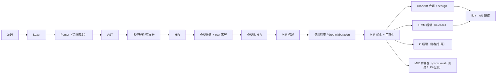
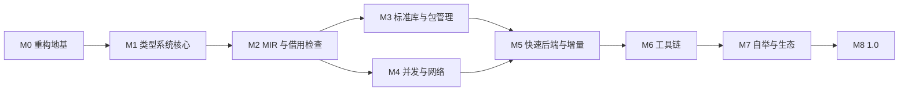

# AE 编程语言：设计宪章与成熟化实施方案

版本：0.3（重构版，取代 0.2）
日期：2026-11-12
状态：原型期（M0 进行中）。旧版 0.2 全文备份于 `自主编程语言完整方案.v0.2-备份.md`。

> 本文只写 **目标、设计规则、路线和门槛**。逐项跑分数字、ADR 细节和证据日志不再写进本文：分别放在 `ae/bench/reports/`、`ae/docs/adr/`、`ae/CHANGELOG.md`。本文控制在可一次读完的长度。

---

## 0. 文档体系

| 文档 | 位置 | 内容 | 更新时机 |
|---|---|---|---|
| 本方案 | 桌面 / `ae/docs/plan.md` | 目标、宪章、路线、门槛 | 阶段切换或方向变化 |
| 语言规范 | `ae/spec/` | 词法、语法、类型、所有权、并发、ABI 规则（只写规则） | 每个特性合入前 |
| ADR | `ae/docs/adr/NNNN-标题.md` | 单个决策：背景、选项、决定、证据、回退 | 每个决策 |
| 基准报告 | `ae/bench/reports/日期-主题.md` | 原始数据、命令、环境、结论 | 每次测量 |
| 变更日志 | `ae/CHANGELOG.md` | 版本间用户可见变化 | 每次发布 |
| 状态表 | 本文 §9 | 各领域 L0–L4 等级 | 每个里程碑 |

---

## 1. 定位

**AE：拥有 Rust 的内存安全与零成本抽象、Go 的简洁语法、并发模型与工具体验的原生编程语言。**

首批平台 Windows x86-64 与 Linux x86-64（同等地位），后续 macOS、ARM64、Wasm。

### 1.1 目标优先级（冲突时自上而下裁决）

1. **安全与正确性**——底线，不可为速度或体积交换。
2. **运行性能与内存**——对标 Rust（release 差距 ≤ 10%）。
3. **编译速度**——对标 Go（开发模式冷构建与增量构建同数量级）。
4. **资源占用**——产物、部署依赖、缓存、工具链体积受预算控制。
5. **通用能力与生态**——长期必达，但不得突破 1–4。

### 1.2 对标对象

主要对标 **Go、Rust**；次要参照 Zig、Odin、Swift、Mojo、Vale、Hylo 的设计思路。Gojo 仅作为同类实验项目参考，不再作为验收基线。

### 1.3 “替代”的含义

“替代 Go/Rust/Python”按场景逐个达成，每个场景要求：同等功能可写、代码量不劣于 Go、性能/内存不劣于 Go 且接近 Rust、工具链与生态满足日常开发。场景清单与等级见 §9，不做笼统宣称。

---

## 2. 语言设计宪章

### 2.1 取舍总表

| 取自 Rust | 取自 Go | 两者都不要 |
|---|---|---|
| 所有权、移动、借用，静态检查、无 GC | 简洁语法、关键字少、一种写法 | 显式生命周期泛滥（默认推断） |
| 代数数据类型 + 穷尽 `match` | 轻量任务 + channel + `select` | 宏系统复杂度（只做受限宏/派生） |
| `Result`/`Option` + `?` | 隐式满足的接口（结构化 trait 对象） | `nil`、GC、`if err != nil` 样板 |
| trait + 泛型单态化 | 单一工具链 build/test/fmt/doc/vet | 继承、异常、隐式转换 |
| 闭包、迭代器零开销 | 快速编译、单文件二进制 | async 函数染色 |
| `unsafe` 明确边界、FFI | 最小版本选择（MVS）包管理 | 运行时反射（用编译期派生代替） |
| `Drop` 确定性释放 | 内置格式化与测试约定 | 头文件、前置声明 |

### 2.2 十条硬规则

1. **一次实现、任意类型**：容器、结果类型、迭代器一律以泛型在语言/标准库层实现；**禁止**新增按元素类型手写的容器家族或预置结果枚举。
2. **内建最小化**：编译器内建只保留无法用语言表达的原语（内存、算术、系统调用桥）；其余进入标准库模块，用方法语法调用。
3. **安全默认静态**：安全代码的保证必须由编译期检查给出；运行时检查仅限边界、溢出、除零等语义性检查，不作为借用/移动的兜底。
4. **生命周期默认推断**：函数内完全推断；签名按省略规则推断；只有无法推断时要求标注。
5. **无函数染色的并发**：`spawn` 普通函数即可；结构化作用域保证任务不越过所借数据。
6. **错误只有一种机制**：`Result[T, E]` + `?` + 上下文；`panic` 只用于违反不变量，默认终止。
7. **开发与发布语义相同**：优化不得改变可观察行为（溢出、边界检查在两种模式都开启）。
8. **按需付费**：不用并发不链接调度器，不用网络不链接网络栈；空程序产物体积有预算。
9. **规范先行**：每个特性先写 `spec/` 与正反测试，再实现。
10. **证据先行**：性能与安全宣称必须指向可重跑的报告；单平台通过只记“单平台验证”。

### 2.3 语法样貌（目标形态，M1 完成时可编译）

```text
use std::{fs, env}

struct Stat { word: String, count: i64 }

fn count(text: &str) -> Map[&str, i64] {
    var m = Map::new()
    for w in text.split_whitespace() { *m.entry(w).or_insert(0) += 1 }
    m
}

fn main() -> Result[(), Error] {
    let path = env::args().nth(1).context("用法: wc <文件>")?
    let text = fs::read_to_string(path)?
    let mut stats = count(&text).iter().map(|(w, n)| Stat { word: w.to_string(), count: n }).collect[Vec[_]]()
    stats.sort_by_key(|s| -s.count)
    for s in stats.iter().take(10) { println("{s.word:>12} {s.count}") }
    Ok(())
}
```

并发形态（M4）：

```text
fn fetch_all(urls: &[String]) -> Vec[Result[Bytes, HttpError]] {
    task::scope(|s| {
        let handles = urls.iter().map(|u| s.spawn(|| http::get(u))).collect[Vec[_]]()
        handles.into_iter().map(|h| h.join()).collect()
    })
}

fn pipeline() {
    let (tx, rx) = channel[i64](capacity: 64)
    task::scope(|s| {
        s.spawn(move || for i in 0..100 { tx.send(i) })
        for v in rx { println("{v}") }
    })
}
```

### 2.4 类型系统清单（1.0 范围）

- 标量：`i8..i128`、`u8..u128`、`isize/usize`、`f32/f64`、`bool`、`char`、`()`、`!`。
- 复合：元组、定长数组 `[T; N]`、切片 `&[T]`、`str`/`String`、结构体、枚举、联合（仅 unsafe）。
- 引用：`&T`、`&mut T`、裸指针 `*const T`/`*mut T`（unsafe）。
- 泛型：类型参数、const 泛型、trait 约束、`where`、关联类型、默认方法、泛型 impl、trait 对象 `dyn Trait`。
- 自动 trait：`Copy`、`Send`、`Sync`、`Sized`；派生：`Clone`、`Eq`、`Ord`、`Hash`、`Debug`、`Display`、`Default`、`Serialize`。
- 运算符重载经 trait；无隐式数值转换；整数溢出默认检查，提供 `wrapping_*`/`checked_*`/`saturating_*`。
- 模式：嵌套、守卫、绑定 `@`、范围、`if let`、`let else`、`while let`。
- 闭包：按捕获方式推断 `Fn`/`FnMut`/`FnOnce`。
- 编译期：`const fn`、编译期求值（基于 MIR 解释器）、受限派生宏。

### 2.5 内存与所有权模型

- 唯一所有者；移动后不可用；`Copy` 类型按值复制。
- 借用：共享借用可并存，可变借用独占；检查基于 **Polonius 风格的 origin/loan 数据流**（比 NLL 误拒更少）。
- `Drop` 在 MIR 上做 drop elaboration，覆盖提前返回、`?`、`break`、panic 终止路径。
- 一等公民 **arena/区域分配**：`Arena::scope(|a| ...)`，用于解析器、请求处理等批量短命对象。
- 分配器接口可替换；默认系统分配器，可选内置 mimalloc 风格分配器（按基准决定）。

### 2.6 并发模型

- `Send`/`Sync` 自动推导，编译期阻止数据竞争。
- 两层 API：`thread::scope`（OS 线程）与 `task::scope`（M:N 有栈协程，work-stealing 调度）。
- I/O：Linux epoll（io_uring 可选）、Windows IOCP；阻塞式 API 在任务内自动让出，无 async/await 染色。
- 同步原语：`Mutex`、`RwLock`、`Condvar`、`Atomic*`、`Arc`、`channel`（有界/无界/`select`）、`Once`、`Barrier`。
- 取消与超时：结构化取消随作用域传播；`deadline` 参数化。

### 2.7 unsafe 与 FFI

- `unsafe { }` 块与 `unsafe fn`；每个 unsafe 函数文档必须列出前置条件。
- `extern "C"` 声明与导出、`#[repr(C)]` 布局、回调、可变参数（仅调用）。
- `ae bindgen` 从 C 头生成绑定；Python 扩展/嵌入作为 M7 官方库。

---

## 3. 编译器架构



### 3.1 原则

- **查询式增量编译**（salsa 风格）：每个阶段是带缓存的纯函数查询，编译器与 LSP 共用同一引擎。
- **以包为编译单元**：包接口摘要参与缓存键；改函数体只重编该包并重链接；改公共接口只重检依赖它的包。（这取代旧方案中被 ADR-38 否决的“按模块拆 C 翻译单元”路线。）
- **并行**：包级并行 + 包内按函数并行代码生成；线程数与内存有上限参数。
- **多错误恢复**：解析与类型检查都收集多个诊断，LSP 不依赖构建成功。
- **每个 IR 有验证器**；IR 可通过 `ae emit --hir/--mir/--c/--asm` 查看。

### 3.2 代码组织（cargo workspace）

```text
ae/
  crates/
    ae-span        源码、位置、诊断
    ae-syntax      lexer、parser、AST、格式化
    ae-hir         名称解析、HIR
    ae-ty          类型推断、trait 求解
    ae-mir         MIR、借用检查、优化、解释器
    ae-codegen-c   C 后端（现有实现迁入）
    ae-codegen-cl  Cranelift 后端
    ae-codegen-llvm LLVM 后端
    ae-driver      CLI、构建、缓存、包管理
    ae-lsp         语言服务器
  runtime/             最小运行时（启动、panic、分配、平台桥、调度器）
  std/                 标准库（AE 源码）core / alloc / std
  spec/                语言规范
  tests/ui/            诊断快照测试（.ae + .stderr）
  tests/run/           运行结果测试（.ae + .stdout）
  bench/               基准程序、运行器、报告
  docs/adr/            决策记录
```

### 3.3 后端策略

| 模式 | 后端 | 目标 | 状态 |
|---|---|---|---|
| `ae run` / `build --debug` | Cranelift | 编译速度对标 Go；不需要用户安装 C 编译器 | M5 |
| `build`（默认 release） | LLVM | 运行性能对标 Rust | M5 |
| 引导/移植 | C 后端 | 新平台快速可用，自举前过渡 | 现有 |

自研机器码后端/链接器只在 Cranelift + lld 被基准证明为瓶颈时单独立项。

---

## 4. 标准库与工具链

### 4.1 标准库分层

- **core**（无分配、无 OS）：基本类型方法、`Option`/`Result`、迭代器、切片、`str`、格式化 trait、原子。
- **alloc**：`Box`、`Vec`、`String`、`Map`（SwissTable 风格）、`Set`、`Deque`、`BTreeMap`、`Rc`、`Arc`、`Arena`。
- **std**：`fs`、`path`、`io`（缓冲读写、流）、`env`、`process`、`time`、`thread`、`task`、`sync`、`net`（TCP/UDP/DNS）、`fmt`、`hash`、`rand`、`json`、`csv`、`regex`、`log`、`test`。
- **官方扩展**（独立版本）：`http`、`tls`、`sqlite`、`postgres`、`serde`、`cli`、`tensor`、`gpu`、`gui`、`python`。

### 4.2 工具命令（单一 `ae` 可执行文件）

`new` `init` `build` `run` `test` `bench` `fmt` `vet`（lint）`doc` `check` `add` `remove` `update` `publish` `cache` `clean` `emit` `version` `lsp`。

### 4.3 包管理

- `ae.toml` 清单 + `ae.lock` 锁文件；依赖来源：注册表、git、路径。
- **最小版本选择（MVS）**：结果确定、无需 SAT 求解。
- 内容哈希校验、离线镜像、平台条件依赖、`workspace`。
- 注册表：静态索引 + 对象存储；签名与撤回策略。

### 4.4 开发体验

- LSP：诊断、补全、跳转、引用、重命名、悬停类型、内联提示、代码操作、格式化。
- 编辑器：VS Code 扩展、tree-sitter 语法；调试：DWARF（Linux）/ CodeView+PDB（Windows），GDB/LLDB/VS 可用。
- 诊断质量：每条错误有错误码、主标签、次标签、修复建议；`ae explain E0xxx`。
- Playground：前端编译到 Wasm，浏览器内 check/运行 MIR 解释器。

---

## 5. 当前状态评估（2026-11-12）

### 5.1 已具备（保留并迁移）

- Rust 编写的单体前端 + 严格 C11 后端；运行时按可达性裁剪、按需引入 `<windows.h>`。
- 基础类型、结构体、枚举、`match`、泛型函数/结构体/枚举、trait v1 静态分派、模块与 `pub`、`?` 传播。
- 文件/路径/目录/进程/环境/时间/JSON 查询等内建；`check --json`、`fmt`、`test`、`cache`、`deps`。
- 双平台测试、生成 C 校验（`--leak`、Linux ASan/UBSan）、ADR 与基准归档纪律。

### 5.2 结构性缺口（M0–M2 必须解决）

| 缺口 | 影响 | 解决阶段 |
|---|---|---|
| 容器是按元素类型手写的家族（`vec`/`vec[string]`/`vec[f64]`/两种 map） | 线性膨胀、不可能覆盖任意类型 | M1 |
| 9 个预置结果枚举，几十个全局内建函数 | 代码啰嗦、命名空间污染 | M1 |
| 无方法语法、闭包、迭代器 | 表达力远低于 Go/Rust | M1 |
| 无 IR，AST 直出 C | 阻塞借用检查、优化、增量、换后端 | M2 |
| 借用检查是受限规则 + 运行时兜底 | 不满足静态安全承诺 | M2 |
| 前端单文件约 330 KB、fail-fast 诊断 | 难协作、无法做 LSP | M0 |
| 编译速度受 GCC 限制 | Go 级编译速度不可达 | M5 |
| 无并发、无网络、无包管理 | Go 核心优势缺失 | M3、M4 |

### 5.3 纠偏决定

1. **立即冻结**新增内建函数、手写容器家族、预置结果枚举、运行时微优化（装载因子、缓冲区调优等），直到 M1 验收。
2. 现有内建在 M1 期间以标准库方法重新实现，旧名保留一个版本作弃用别名，随后删除。
3. 现有 C 后端迁入 `ae-codegen-c`，在 M2 改为从 MIR 生成。

---

## 6. 实施路线（M0–M8）



每个里程碑内部固定流程：**规范与测试用例 → 实现 → UI/运行测试 → 双平台验证 → 基准报告 → ADR → 复核进入下一项**。

### M0：重构地基（零行为变化）

| # | 步骤 | 产出 | 验收 |
|---|---|---|---|
| 0.1 | 写 ADR：设计宪章（§2）与冻结清单（§5.3） | `docs/adr/0100-charter.md` | 合入 |
| 0.2 | 拆 `docs/decisions.md` 为单文件 ADR；跑分段落移入 `bench/reports/` | `docs/adr/*`、`bench/reports/*` | 链接无断裂 |
| 0.3 | 建 cargo workspace，按 §3.2 拆 `frontend.rs`（先机械搬迁） | 各 crate | 全部测试通过、所有示例 `emit-c` 逐字节不变 |
| 0.4 | 统一 `Span` 与 `Diagnostic`（错误码、主次标签、建议） | `ae-span` | 现有诊断文本快照不变 |
| 0.5 | 解析器错误恢复、类型检查继续收集错误，`check --json` 输出多条 | — | 新增 30+ 多错误 UI 用例 |
| 0.6 | UI 测试框架：`tests/ui/*.ae` + `.stderr` 快照，`--bless` 更新 | 测试驱动 | 迁移现有集成测试中的诊断断言 |
| 0.7 | 运行测试框架：`tests/run/*.ae` + `.stdout` | — | 迁移 `examples/` 输出断言 |
| 0.8 | 清理仓库根目录（大文件进 `bench/data/`，`.gitignore`）；CI 双平台矩阵 + 缓存 | CI | 双平台绿 |
| 0.9 | 基准运行器统一为 `ae bench` 预备脚本，报告模板固定 | `bench/` | 生成一份基线报告 |

### M1：类型系统核心

| # | 步骤 | 验收 |
|---|---|---|
| 1.1 | 规范：类型、推断、trait、方法解析、模式、闭包（`spec/types.md` 等） | 规范评审通过 |
| 1.2 | AST → HIR 降级；名称解析支持 `impl` 块、关联项、路径 `Type::item` | UI 用例 |
| 1.3 | 双向类型推断 + 统一（unification），局部变量与泛型实参可推断 | `let v = Vec::new(); v.push(1)` 可编译 |
| 1.4 | 完整整数族、`f32`、`char`、`usize`、元组、切片、`str`/`String` 分离 | 每类型正反用例 |
| 1.5 | `impl` 块与方法语法、`self`/`&self`/`&mut self`、自动借用/解引用 | — |
| 1.6 | trait 完整化：泛型 impl、默认方法、关联类型、`where`、一致性（孤儿规则）、trait 对象 vtable | trait 用例矩阵 |
| 1.7 | 运算符 trait、`Drop`、`Clone`/`Copy`、派生（`#[derive(...)]`） | — |
| 1.8 | 闭包（捕获推断）与 `Iterator` trait；适配器 `map/filter/enumerate/zip/take/collect` | 迭代器链生成代码与手写循环性能差 ≤ 5% |
| 1.9 | 模式增强：嵌套、守卫、`if let`、`let else`、`while let`、穷尽性与可达性检查 | — |
| 1.10 | 用语言自身实现 `Vec[T]`、`String`、`Map[K,V]`、`Set[T]`、`Option`、`Result`；运行时仅留类型无关原语 | 删除 `vec[f64]`、`strvec_new`、`f64map_new` 等，旧名弃用别名 |
| 1.11 | 统一错误：`Result[T, E]`、`std::Error` trait、`.context()`；删除预置结果枚举 | 所有示例迁移 |
| 1.12 | 格式化字符串插值 `"{x:>8.2}"`，编译期解析 | — |
| 1.13 | 迁移全部 `examples/` 到新语法；对照 Go 写同功能程序 | 示例平均代码行数 ≤ Go 版本 |
| 1.14 | 性能回归检查：map/text/sum 负载不劣于冻结前基线 10% 以上 | 基准报告 |

### M2：MIR 与借用检查

| # | 步骤 | 验收 |
|---|---|---|
| 2.1 | 规范：资源模型 v2（所有权、借用、origin/loan、drop 顺序、两阶段借用） | 评审 |
| 2.2 | MIR 定义（基本块、Place/Rvalue/Terminator）+ 验证器 + 文本打印 | `emit --mir` |
| 2.3 | THIR → MIR 构建；C 后端改为从 MIR 生成 | 全部 run 测试通过 |
| 2.4 | drop elaboration（含 drop flag），删除运行时空检查兜底 | `--leak`/ASan 全绿 |
| 2.5 | 借用检查 L1：局部借用 + 活跃度（NLL） | 对抗矩阵 10 类全部拒绝 |
| 2.6 | L2：签名生命周期省略与推断 | — |
| 2.7 | L3：结构体内借用、显式 `'a` | — |
| 2.8 | L4：两阶段借用、重借用、借用分裂（字段级） | — |
| 2.9 | L5：闭包捕获借用检查；Polonius 风格 origin 计算 | 移植改写 Rust borrowck UI 典型用例 |
| 2.10 | MIR 优化：常量传播、死代码、内联、边界检查消除（需证明） | 优化前后差分测试 |
| 2.11 | MIR 解释器：`const fn`、编译期求值、UB 检测模式（类似 Miri） | `ae test --interp` |
| 2.12 | `unsafe`、裸指针、`extern "C"`、`#[repr(C)]` | FFI 用例双平台 |
| 2.13 | 差分模糊：随机程序生成器，对比 interp / -O0 / -O2 / ASan | 连续 24 小时无新发现 |

### M3：标准库与包管理

| # | 步骤 | 验收 |
|---|---|---|
| 3.1 | `core`/`alloc`/`std` 分层落地（§4.1），文档注释与示例测试 | `ae doc` 可生成 |
| 3.2 | `io` 缓冲读写、流式处理；`fs`/`path` 覆盖 Unicode、权限、符号链接 | 平台差异文档 |
| 3.3 | `json`（派生序列化）、`csv`、`regex`（自研 DFA/回溯混合或绑定）、`log`、`rand`、`time` | 各库基准与 Go 标准库对照 |
| 3.4 | `ae.toml`/`ae.lock`、MVS 解析、git/路径依赖、内容哈希 | 依赖解析测试集 |
| 3.5 | 包级编译与缓存：接口摘要进缓存键 | 改函数体只重编 1 个包 |
| 3.6 | `ae new/add/update/publish`；注册表原型 | 新用户 5 分钟完成带 2 个依赖的 CLI |
| 3.7 | 真实工具：grep、文件整理、日志分析、CSV 转换，与 Go/Python 对照 | 报告 |

### M4：并发与网络

| # | 步骤 | 验收 |
|---|---|---|
| 4.1 | 规范：`Send`/`Sync`、作用域任务、取消、内存模型（采用 C++20/Rust 原子模型） | 评审 |
| 4.2 | `thread::scope`、`Mutex`、`RwLock`、`Atomic*`、`Arc`、`Condvar` | 数据竞争拒绝用例；Linux TSan |
| 4.3 | `channel`（有界/无界/`select`） | 吞吐基准对照 Go |
| 4.4 | M:N 调度器：有栈协程、work-stealing、栈增长/分段策略 | 100 万任务创建内存 ≤ Go |
| 4.5 | I/O 驱动：epoll / IOCP；阻塞 API 在任务内自动让出 | — |
| 4.6 | `net`：TCP/UDP/DNS/定时器/超时/取消 | 双平台协议测试 |
| 4.7 | `http` 1.1 客户端与服务器；`tls` 绑定 rustls（C ABI）或系统库 | echo 吞吐 ≥ Go `net/http` 80%，内存 ≤ 50% |
| 4.8 | TCP/UDP 转发代理样例：规则、连接统计、平滑关闭 | 24 小时压测无泄漏 |

### M5：快速后端与增量编译

| # | 步骤 | 验收 |
|---|---|---|
| 5.1 | MIR → Cranelift，生成 ELF/COFF 目标文件 | run 测试全绿 |
| 5.2 | 内置 lld 驱动链接；Windows 不再要求用户安装 MinGW/MSVC | 干净 Windows 机安装即用 |
| 5.3 | 调试信息 DWARF / CodeView | GDB/VS 断点可用 |
| 5.4 | 查询式增量引擎（前端全阶段） | 改函数体增量 < 100 ms（1 万行项目） |
| 5.5 | 包级与函数级并行代码生成 | 多核扩展效率报告 |
| 5.6 | MIR → LLVM release 后端 | release 基准与 Rust 差距 ≤ 10% |
| 5.7 | 10 万行合成项目对照 Go：冷/无修改/改实现/改接口 | 同数量级 |

### M6：工具链

| # | 步骤 | 验收 |
|---|---|---|
| 6.1 | LSP（基于查询引擎）全部功能（§4.4） | 10 万行项目补全延迟 < 100 ms |
| 6.2 | VS Code 扩展、tree-sitter 语法 | 发布 |
| 6.3 | `ae vet` lint、`ae bench`、覆盖率 | — |
| 6.4 | `ae doc` 站点、`ae explain` | — |
| 6.5 | Wasm Playground | 在线可用 |

### M7：自举与生态

| # | 步骤 | 验收 |
|---|---|---|
| 7.1 | 用 AE 重写编译器（逐 crate 迁移，先 syntax） | 自举编译器通过全部测试，三代编译产物一致 |
| 7.2 | `bindgen`、Python 扩展/嵌入、NumPy 数组桥 | 双向示例 |
| 7.3 | 官方库：`serde`、`cli`、`sqlite`、`postgres`、Web 框架 | 每库 L2 |
| 7.4 | 平台扩展：macOS、ARM64、Wasm、交叉编译 | CI 矩阵 |
| 7.5 | 数据与 GPU：`tensor`（CPU 参考实现）→ 单一 GPU 后端试点 | 推理示例与 PyTorch 对照 |
| 7.6 | 社区：RFC 流程、edition 机制、安全响应、注册表上线 | — |

### M8：1.0 发布门槛

- 规范冻结，edition 兼容承诺；自举编译器；三平台 CI。
- 无已知未缓解严重安全缺陷；unsafe 审计完成。
- 公开基准：编译 vs Go、运行/内存 vs Rust/Go、真实工作流 vs Python，全部可复现。
- 至少 3 个真实项目（CLI、Web 服务、网络代理）生产使用。
- 完整文档：入门教程、语言参考、标准库 API、迁移指南（Go/Rust/Python → AE）。

---

## 7. 质量与证据体系

### 7.1 测试分层

| 层 | 内容 | 工具 |
|---|---|---|
| 单元 | 各 crate 内部 | `cargo test` |
| UI | 诊断快照（正例无错、反例精确报错） | `tests/ui` |
| 运行 | 输出与退出码 | `tests/run` |
| 安全 | 借用对抗矩阵、unsafe 封装、数据竞争 | UI + TSan |
| 差分 | interp / 各后端 / 各优化级 | 模糊生成器 |
| 内存 | 泄漏、越界、UB | `--leak`、ASan/UBSan、MIR UB 模式 |
| 平台 | Unicode 路径、权限、行尾、进程 | 双平台 CI |
| 性能回归 | 编译与运行基准，阈值告警 | `ae bench` + CI |

### 7.2 基准规则

- 同机同平台、同功能同输入、输出校验；固定工具链版本。
- 报告样本数、中位数、波动区间；交错运行；保存原始数据与命令。
- 编译：冷/无修改/改实现/改接口，墙钟、CPU、峰值内存、缓存体积。
- 运行：墙钟、CPU、峰值 RSS、产物与部署体积；网络加 p50/p95/p99；GPU 加显存与传输。
- 标准负载：空程序、文件搜索、文本处理、map 计数、数值数组、JSON 解析、HTTP 服务、多模块构建、并发管道。

### 7.3 宣称规则（负面清单原则）

对外宣称必须同时满足：双平台验证 + 可重跑报告 + 公平对照。具体不得越过的表述随状态表维护在 `ae/docs/claims.md`，本文不再逐条罗列。

---

## 8. 风险与应对

| 风险 | 应对 |
|---|---|
| 范围过大、长期不可用 | 严格按 M 顺序；每个 M 都产出可用版本；冻结清单防止分散 |
| 借用检查误拒太多导致难用 | 先 NLL 后 Polonius；收集误拒用例集，可用性作为验收项 |
| 借用检查不健全 | 对抗矩阵 + 差分模糊 + MIR UB 解释器 + 外部审查 |
| 编译速度不达标 | Cranelift + 查询增量 + 包并行；单态化膨胀设预算（共享实例、多态化优化） |
| 协程调度器复杂 | 先 `thread::scope` 交付安全并发，再上 M:N；调度器可选链接 |
| C 后端 UB 泄漏到语义 | M2 后 C 后端只作引导；生成模板审查 + 净化器 |
| 生态冷启动 | C/Python 互操作优先；官方库覆盖高频场景；包管理器尽早上线 |
| 自研边界失控 | 允许使用 Cranelift、LLVM、lld、rustls 等成熟组件；自研替代须单独 ADR 与基准理由 |

---

## 9. 场景状态表（L0 规划 / L1 示例可运行 / L2 双平台核心流程 / L3 文档+性能+发布门槛 / L4 生产验证）

| 场景 | 当前 | 目标里程碑与等级 | 替代对象 |
|---|---|---|---|
| 语言核心（类型/泛型/trait） | L1 | M1 → L2，M8 → L4 | Go、Rust |
| 内存安全（静态借用） | L1 | M2 → L2 | Rust |
| 自动化脚本与 CLI | L2 | M3 → L3 | Python、Go |
| 文本/数据处理 | L1 | M3 → L3 | Python |
| 并发与网络服务 | L0 | M4 → L2，M7 → L3 | Go |
| 网络代理 | L0 | M4 → L2 | Go、Rust |
| 编译速度 | L1 | M5 → L3 | Go |
| 开发工具（LSP/调试/包管理） | L1 | M6 → L3 | Go、Rust |
| 系统编程/FFI | L0 | M2 → L2，M7 → L3 | C、Rust |
| 数据科学/GPU | L0 | M7 → L2 | Python |
| 桌面/图形 | L0 | 1.0 之后 | — |
| Wasm/嵌入式/移动 | L0 | M7 起评估 | — |

---

## 10. 立即执行清单（M0 起步）

1. ☐ 合入设计宪章 ADR 与冻结清单（M0.1）。
2. ☐ 拆分 ADR 文档、迁移跑分到报告目录（M0.2）。
3. ☐ 建 workspace、机械拆分前端，`emit-c` 逐字节对比全部示例（M0.3）。
4. ☐ 诊断基础设施与多错误恢复（M0.4–0.5）。
5. ☐ UI/运行快照测试框架并迁移旧测试（M0.6–0.7）。
6. ☐ 清理仓库、双平台 CI、基线报告（M0.8–0.9）。
7. ☐ 开始 M1.1：类型系统规范。

附：本文是设计与实施计划，不表示所列能力已实现。实际进度以 §9 状态表和各报告为准；路线可依据证据调整，但 §1.1 优先级与 §2.2 硬规则的修改必须通过 ADR。
